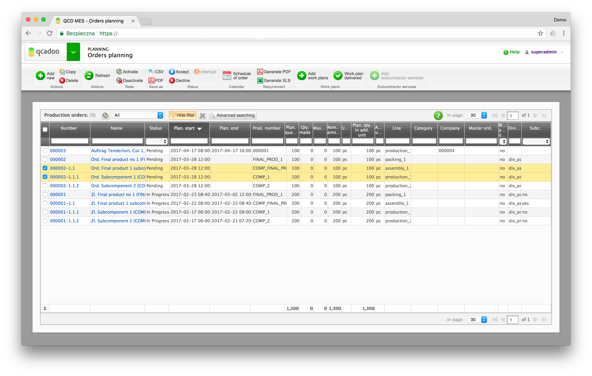

<p align="center">
  <a href="https://qcadoo.com">
    
  </a>
</p>

<h1 align="center">qcadoo MES</h1>

<p align="center">
  面向中小型制造企业的开源 Web 化生产管理系统<br/>
  Open-source web-based manufacturing execution system for SMBs
</p>

<p align="center">
  <a href="https://github.com/seth-zou/MES-qcadoo/releases/latest"></a>
  
  
  
</p>

---



## 简介

qcadoo MES 是一款面向中小型制造企业的 Web 化生产管理系统（MES）。它将大型 ERP 系统的核心能力——生产订单管理、工艺路线、物料需求、库存流转、设备维护、成本核算等——以轻量、灵活的方式交付给中小型团队，帮助企业快速建立数字化生产管理流程。

**核心功能模块：**

| 领域 | 模块 | 说明 |
| --- | --- | --- |
| 生产管理 | 订单、排程、班次 | 生产订单全生命周期管理、按班次排产 |
| 工艺管理 | 工艺路线、工序 | 定义产品工艺路线、工序与工时定额 |
| 物料管理 | 物料需求、采购、库存 | MRP 运算、供应商报价、仓库物料流转 |
| 质量管理 | 追溯、偏差 | 产品谱系追溯、偏差原因报告 |
| 设备维护 | CMMS | 设备备件管理、停机记录、维护计划 |
| 成本核算 | 工时与物料成本 | 订单级与工序级成本计算 |
| 计划排程 | 甘特图、换线 | 甘特排产视图、换线时间定额 |

## 快速开始

### 方式一：直接下载二进制发布包（推荐）

前往 [GitHub Releases](https://github.com/seth-zou/MES-qcadoo/releases/latest) 下载最新的稳定版本，解压后按附带的部署说明启动即可。

### 方式二：从源码构建

```bash
# 1. 克隆仓库
git clone https://github.com/seth-zou/MES-qcadoo.git
cd MES-qcadoo

# 2. 编译构建（需要 JDK 8+ 和 Maven 3.x）
mvn clean install -DskipTests

# 3. 启动应用（Tomcat profile）
cd mes-application
mvn tomcat:run
```

启动后访问 `http://localhost:8080/mes` 即可进入系统。

> 📖 更详细的构建教程请参阅 [官方文档](https://qcadoo.atlassian.net/wiki/display/QCDMESDOC/Building+MES+from+source+code+-+tutorial)。

## 项目结构

```
MES-qcadoo/
├── mes-application/      # Web 应用入口与装配模块
├── mes-plugins/          # 业务插件（55+ 模块，按功能领域划分）
│   ├── mes-plugins-basic/               # 基础数据（产品、物料、部门等）
│   ├── mes-plugins-orders/              # 生产订单
│   ├── mes-plugins-technologies/        # 工艺路线
│   ├── mes-plugins-material-flow/       # 物料流转
│   ├── mes-plugins-production-scheduling/ # 生产排程
│   ├── mes-plugins-deliveries/          # 采购交付
│   ├── mes-plugins-cmms-machine-parts/  # 设备维护
│   ├── mes-plugins-cost-calculation/    # 成本核算
│   └── ...                              # 更多模块
├── pom.xml               # Maven 顶层构建配置
└── LICENSE.txt           # AGPLv3 许可证
```

项目采用 qcadoo 插件化架构，每个业务领域是独立的 Maven 模块，可以按需启用或组合。

## Community vs Commercial 版本

qcadoo MES 提供两个版本：

- **Community 版本**（本仓库）：开源的社区版本，包含核心 MES 功能。
- **Commercial 版本**：由 [Qcadoo Limited](https://qcadoo.com/en/) 开发和销售的商业版本。

Commercial 版本额外提供：

- 完整的技术支持
- SaaS 部署方案
- REST API 集成接口
- 主流 ERP 软件、Pipedrive、SCADA 的现成集成模块
- 高级功能（甘特计划排程、仓库物料流转、维护计划模块等）

## 技术栈

- **后端**：Java 8、Spring Framework、Hibernate
- **前端**：qcadoo View 框架（基于服务端渲染）
- **构建**：Maven 3.x
- **数据库**：PostgreSQL / H2（开发环境）
- **运行容器**：嵌入式 Tomcat

## 许可证

本项目基于 [GNU AGPLv3](LICENSE.txt) 开源协议发布。
